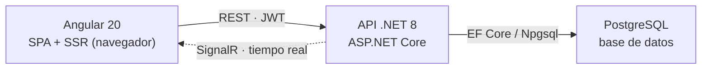

# Zezame

> Aplicación de **registro de tiempo laboral** para equipos. En la línea de Sesame: fichar la jornada,
> hacer pausas, asociar cada sesión a un proyecto y una actividad, y verlo todo en un calendario y en
> reportes.

**Stack:** Angular 20 · .NET 8 (ASP.NET Core) · PostgreSQL · SignalR · JWT

---

## Qué es y para qué sirve

El corazón de Zezame es un **cronómetro**: el usuario ficha cuando empieza a trabajar, hace pausas
cuando descansa y detiene la jornada al terminar. Cada entrada de tiempo puede asociarse a un
**proyecto** y a una **actividad** concreta, de modo que después se sabe en qué se fue el tiempo.

Sobre esa base añade:

- **Proyectos** con miembros, tareas, progreso y estado.
- **Calendario** con mapa de calor de horas por día y detalle diario.
- **Reportes** de productividad: totales, gráfico semanal, reparto por proyecto y ranking de equipo.
- **Ajustes** de perfil, apariencia (tema claro/oscuro) y seguridad.

El estado del cronómetro se sincroniza **en tiempo real** entre pestañas y dispositivos mediante SignalR.

---

## Arquitectura

Tres piezas: una **SPA de Angular** en el navegador, una **API REST** en .NET que aplica la lógica y
la seguridad, y una base de datos **PostgreSQL**. El backend sigue una arquitectura por capas
(Dominio · Infraestructura · Api). Además del REST clásico, un canal **SignalR** empuja los cambios
del cronómetro al instante.



> El cronómetro viaja por REST para guardarse y por SignalR para reflejarse al instante en cada cliente.

---

## Tecnologías

| Capa | Herramientas |
|---|---|
| **Frontend** | Angular 20 (standalone, signals, control-flow), SSR, Tailwind 3, lucide-angular, `@microsoft/signalr`, RxJS |
| **Backend** | ASP.NET Core (API REST), EF Core (Npgsql), SignalR, JWT Bearer, BCrypt, Swagger |
| **Datos e infra** | PostgreSQL 15 (Docker), migraciones EF, `user-secrets`, Clean Architecture |

---

## Modelo de datos

Cinco entidades. Todas comparten `Id`, fechas de creación/actualización y borrado lógico (`IsDeleted`).

| Entidad | Descripción |
|---|---|
| **User** | Usuario: email, contraseña (hash BCrypt), nombre, `Role` (User/Coordinator/Admin), zona horaria e idioma. |
| **Project** | Proyecto: nombre, descripción, color, emoji, `Status` (Active/Paused/Completed), fecha límite y un dueño. |
| **ProjectMember** | Une un `User` con un `Project` — así un proyecto tiene equipo. |
| **Activity** | Tarea dentro de un proyecto: nombre, emoji, `Status`, estimación y asignación. |
| **TimeEntry** | El fichaje: inicio, fin, duración, `Type` (**Work** o **Break**) y referencias opcionales a proyecto y actividad. |

---

## Módulos de la aplicación

| Módulo | Qué hace |
|---|---|
| **Timer** (inicio) | Cronómetro con play / pausa / reanudar / stop, meta diaria, proyectos activos y diálogo para asociar la sesión a un proyecto y actividad. |
| **Proyectos** | Rejilla o lista con horas, progreso, miembros y estado. Filtros y búsqueda. |
| **Calendario** | Mapa de calor mensual por horas trabajadas, detalle del día y resumen semanal. |
| **Reportes** | Horas totales, productividad, gráfico semanal, tarta por proyecto, ranking de equipo y actividad diaria. |
| **Ajustes** | Perfil, notificaciones, apariencia (claro/oscuro/sistema), seguridad (cambio de contraseña) y facturación. |
| **Landing + Acceso** | Página pública de presentación y modal de inicio de sesión / registro. |

---

## Roles y seguridad

Autenticación con **JWT** (token de 24 h). El registro público siempre crea un usuario básico; los
roles elevados los concede un administrador. Contraseñas con **BCrypt** y claves sensibles en
`user-secrets`, fuera del repositorio.

| Rol | Puede |
|---|---|
| `User` | Fichar su tiempo, ver sus proyectos, calendario y reportes propios. |
| `Coordinator` | Además: crear y gestionar proyectos, crear actividades, añadir miembros y ver el ranking del equipo. |
| `Admin` | Control total sobre cualquier proyecto y recurso. |

---

## Cómo ejecutarla en local

### 1. Base de datos (Docker)

La app espera la base `zezame_db` en el puerto 5432.

```bash
docker run --name zezame-db -e POSTGRES_USER=postgres \
  -e POSTGRES_PASSWORD=masterkey -e POSTGRES_DB=zezame_db \
  -p 5432:5432 -d postgres
```

### 2. Backend (.NET)

Configura los secretos, aplica las migraciones y arranca la API en `https://localhost:7107`.

```bash
cd zezame-backend

# claves fuera del repo (una sola vez)
dotnet user-secrets set "Jwt:Key" "<clave-de-32+-caracteres>" --project Zezame.Api
dotnet user-secrets set "ConnectionStrings:Default" \
  "Host=localhost;Port=5432;Database=zezame_db;Username=postgres;Password=masterkey" --project Zezame.Api

dotnet ef database update -p Zezame.Infrastructure -s Zezame.Api
dotnet run --project Zezame.Api --launch-profile https
```

> Swagger queda disponible en `https://localhost:7107/swagger` en desarrollo.

### 3. Frontend (Angular)

Instala dependencias y sirve la SPA en `http://localhost:4200`.

```bash
cd zezame-frontend
npm install
npm start
```

---

## Estructura del repositorio

```
zezame-backend/            # API .NET (Clean Architecture)
  Zezame.Domain/           # entidades y contratos (interfaces)
  Zezame.Infrastructure/   # EF Core, repositorios, migraciones
  Zezame.Api/              # controladores, servicios, SignalR, JWT
zezame-frontend/           # SPA Angular 20
  src/app/core/            # servicios, guard, interceptor, modelos
  src/app/auth/            # login / registro
  src/app/dashboard/       # timer, proyectos, calendario, reportes, ajustes
  src/app/shared/          # landing, navbar, sidebar, modales
docs/                      # documentación y plan de migración
```

---

## Documentación

- **Documentación visual (página):** `docs/zezame-overview.html`
- **Plan de migración React → Angular:** [`docs/PLAN-MIGRACION-PLANTILLA.md`](docs/PLAN-MIGRACION-PLANTILLA.md)
